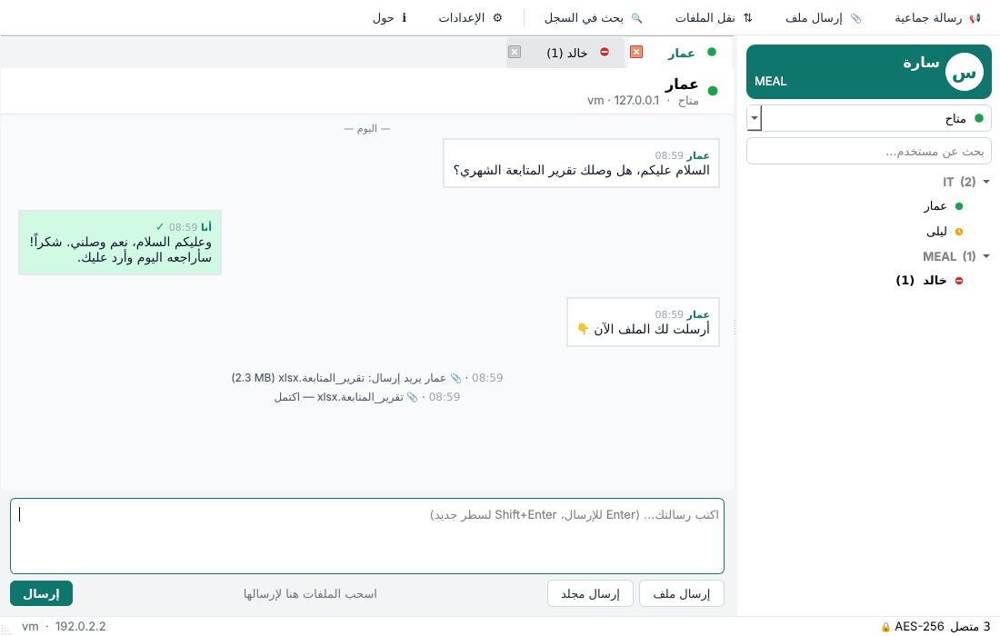
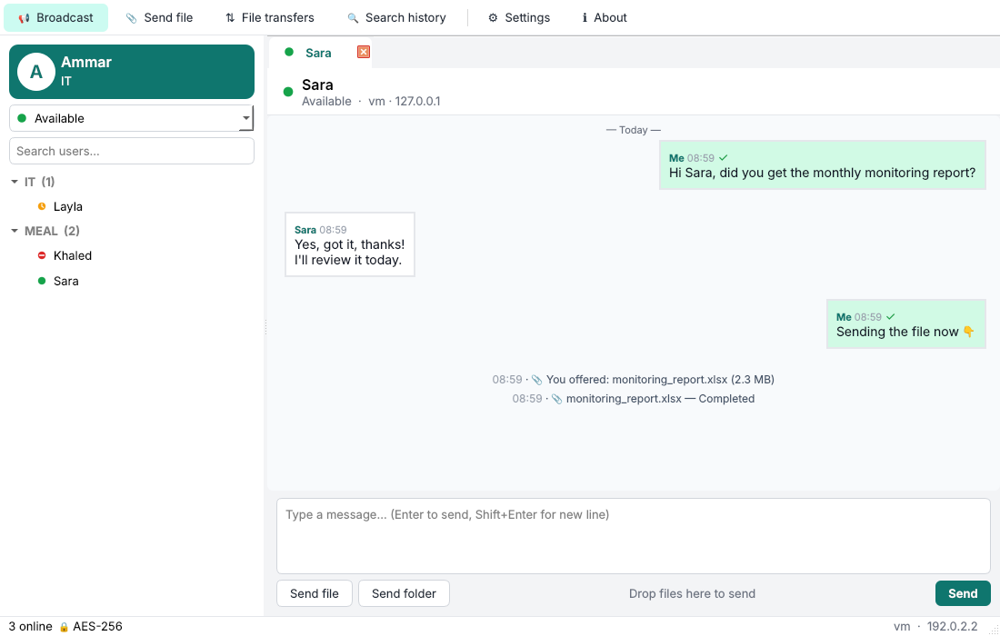

# TDA — مراسل الشبكة المحلية (LAN Messenger)

## ⬇️ تحميل البرنامج

**[اضغط هنا لتحميل آخر نسخة (TDA-Setup.exe)](https://github.com/omarhowari/omar/releases/latest/download/TDA-Setup.exe)**

أو من صفحة [Releases](https://github.com/omarhowari/omar/releases/latest). يعمل على Windows 10 و 11 (64-bit).

<p align="center"></p>

**TDA** برنامج محادثة فورية مفتوح المصدر للشبكات المحلية (مكاتب، منظمات، فروع).
يعمل **بدون خادم وبدون إنترنت**: شغّل البرنامج على كل حاسب في الشبكة نفسها وسيظهر المستخدمون لبعضهم تلقائياً.



> ترخيص MIT — يمكنك استخدامه وتعديله وتوزيعه مجاناً، حتى تجارياً.

---

## المزايا

| الميزة | التفاصيل |
|---|---|
| 🔎 اكتشاف تلقائي | يظهر كل من يشغّل TDA على الشبكة نفسها خلال ثوانٍ، دون أي إعداد |
| 💬 محادثات فردية | نوافذ محادثة بتبويبات، مع علامة التسليم ✓ أو ✗ لكل رسالة |
| 📢 رسائل جماعية | أرسل رسالة واحدة إلى عدة مستخدمين أو إلى الجميع |
| 📎 نقل الملفات والمجلدات | أي نوع ملفات: اسحبها إلى المحادثة أو إلى اسم المستخدم، أو الصقها بـ Ctrl+V (حتى لقطات الشاشة). تظهر كبطاقة داخل المحادثة فيها قبول/رفض/فتح، مع معاينة للصور ودون حد للحجم |
| 📞 مكالمات صوتية | مكالمة مباشرة بين جهازين عبر الشبكة الداخلية (UDP مشفّر)، مع رنين وكتم للميكروفون وسجل للمكالمات والمكالمات الفائتة |
| 🔒 تشفير | تشفير اختياري AES‑256‑GCM لكل الرسائل والملفات بكلمة سر مشتركة للشبكة |
| 👥 مجموعات / أقسام | يُصنَّف المستخدمون حسب القسم (IT، MEAL، المالية…) |
| 🟢 الحالة | متاح / بعيد / مشغول، وتتحول إلى «بعيد» تلقائياً عند عدم النشاط |
| 🗂️ سجل المحادثات | محفوظ محلياً (SQLite)، مع إمكانية البحث فيه |
| 🔔 إشعارات | إشعار في شريط المهام، ووميض النافذة، وصوت تنبيه |
| 🌐 عربي / English | واجهة عربية كاملة من اليمين لليسار، وأخرى إنجليزية |
| 🖥️ شريط المهام | يعمل في الخلفية، ويمكن تشغيله مع بدء Windows |
| 🛰️ شبكات فرعية | أضف عناوين بث أو IP لشبكات فرعية أخرى (VLAN أو فروع عبر VPN) |

## التشغيل السريع (Windows)

### الطريقة 1: المثبّت الجاهز (الأسهل)
شغّل `TDA-Setup.exe` على كل جهاز، ثم افتح **TDA** من سطح المكتب.
يضيف المثبّت قاعدة جدار الحماية تلقائياً. يعمل على Windows 10 و 11 (64-bit).

**نسخة محمولة بدون تثبيت:** فك ضغط `TDA-portable.zip` وشغّل `TDA\TDA.exe`.

### الطريقة 2: من الكود المصدري
1. ثبّت [Python 3.10 أو أحدث](https://www.python.org/downloads/) وفعّل خيار *Add to PATH*.
2. شغّل `run.bat` (أو `python main.py`).

### الطريقة 3: بناء ملف exe بنفسك
شغّل `build_windows.bat`، فيظهر البرنامج في `dist\TDA\TDA.exe`.
إذا كان [Inno Setup 6](https://jrsoftware.org/isdl.php) مثبّتاً، يُبنى المثبّت أيضاً في `dist\`.

### بناء نسخة Windows من Linux
`packaging/windows/build_portable.sh` يبني `TDA.exe` و `TDA-Setup.exe` و `TDA-portable.zip`
باستخدام Python 3.13 embeddable الرسمي و mingw-w64 و NSIS.

### البناء التلقائي عبر GitHub
ارفع المشروع إلى مستودع GitHub، وسيبني ملف `.github/workflows/build-windows.yml` تلقائياً
المثبّت ونسخة محمولة (zip). وعند إنشاء وسم `v1.0.0` تُنشر نسخة Release.

## الإعداد

- **الاسم والقسم**: من ⚙ الإعدادات.
- **كلمة سر الشبكة**: يجب أن تكون **متطابقة** على كل الأجهزة. الأجهزة بكلمات سر مختلفة لا ترى بعضها.
- **المنافذ**: ‏UDP ‏47100 للاكتشاف، و‏TCP ‏47101 للرسائل والملفات. يجب أن تكون نفسها على كل الأجهزة.
- **جدار الحماية**: المثبّت يضبطه تلقائياً. عند التشغيل من الكود، اسمح لـ Python عندما يسأل Windows.
- **شبكات فرعية أخرى**: في «عناوين إضافية» اكتب عنوان البث للشبكة الأخرى (مثل `192.168.2.255`) أو عنوان IP جهاز معيّن.

## البنية التقنية

```
main.py               نقطة البدء (نسخة واحدة لكل مستخدم)
tda/network.py        الاكتشاف عبر UDP، والرسائل ونقل الملفات عبر TCP (حلقة أحداث Qt، بلا خيوط)
tda/protocol.py       تأطير الرسائل وتنظيف مسارات الملفات (منع path traversal)
tda/crypto.py         AES-256-GCM + PBKDF2-SHA256
tda/history.py        سجل المحادثات (SQLite)
tda/calls.py          المكالمات الصوتية: إشارات عبر TCP وصوت PCM 16kHz عبر UDP مشفّر (sounddevice/PortAudio)
tda/branding.py       الشعار والصور المخصّصة وكلمة سر المدير
tda/ui/               الواجهة (PySide6 / Qt 6)
tests/                اختبارات الشبكة والواجهة
installer/TDA.iss     مثبّت Inno Setup
```

**البروتوكول باختصار:**
- كل جهاز يبث كل 5 ثوانٍ حزمة UDP ‏`hello` (المعرّف، الاسم، القسم، الحالة، منفذ TCP). من لا يُسمع لمدة 18 ثانية يُعدّ غير متصل، وعند الإغلاق يُرسل `bye`.
- الرسائل: اتصال TCP يحمل إطاراً `msg` ويرد المستلم بـ `ack` (تأكيد التسليم).
- الملفات: يرسل المرسل `file_offer`، فيرد المستلم بـ `file_accept` أو `file_reject`، ثم يفتح المرسل اتصالاً ويرسل البيانات بقطع 256KB، ويرد المستلم بـ `file_done`.
- الإطار: طول من 4 بايت، ثم الحمولة (مشفّرة بـ AES-GCM مع nonce عشوائي إذا كانت كلمة السر مفعّلة).

## الاختبارات

```bash
pip install -r requirements.txt
python -m tests.test_network      # اكتشاف + محادثة + ملفات + مجلدات + تشفير + عزل كلمات السر
python -m tests.test_calls        # مكالمة كاملة بصوت تجريبي: رد، كتم، رفض، فائتة، مشغول، انقطاع
python -m tests.ui_smoke ar       # يفتح 4 نوافذ تتحادث وترسل ملفات وتتصل ويحفظ لقطات شاشة
```

---

## English

**TDA** is a free, open-source, serverless LAN messenger for Windows (it also runs on Linux and macOS).
Features: automatic peer discovery, private chats with delivery receipts, broadcast messages, file and folder transfer,
optional AES-256-GCM encryption, departments/groups, statuses with auto-away, searchable local history,
tray notifications, and Arabic (RTL) and English UI.

- Run from source: `pip install -r requirements.txt && python main.py`
- Build: `build_windows.bat` (PyInstaller + Inno Setup), or push to GitHub and let Actions build the installer.
- Ports: UDP 47100 (discovery), TCP 47101 (messages/files).



License: MIT.
